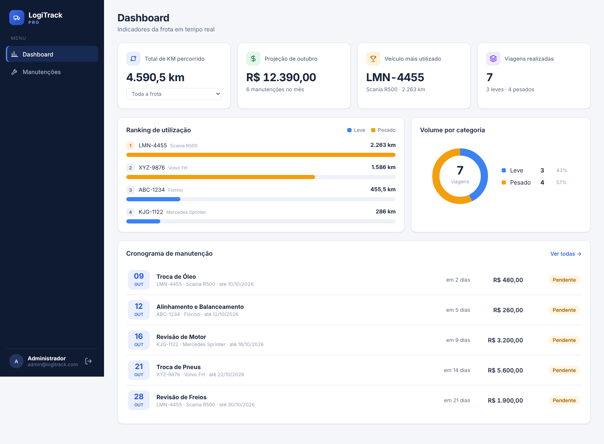
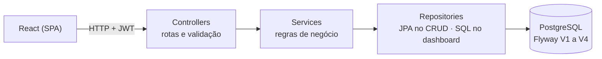
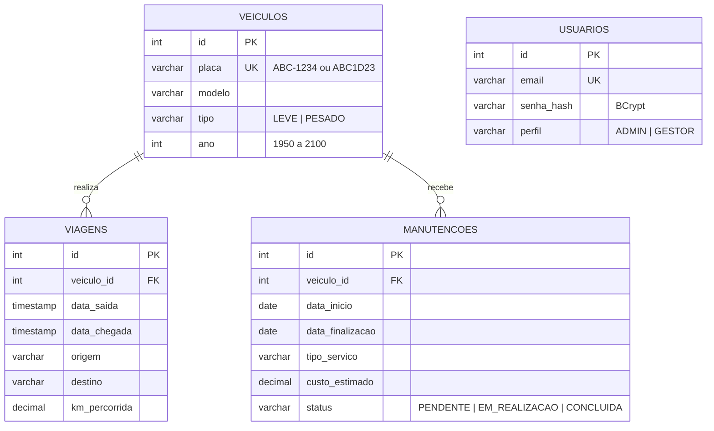
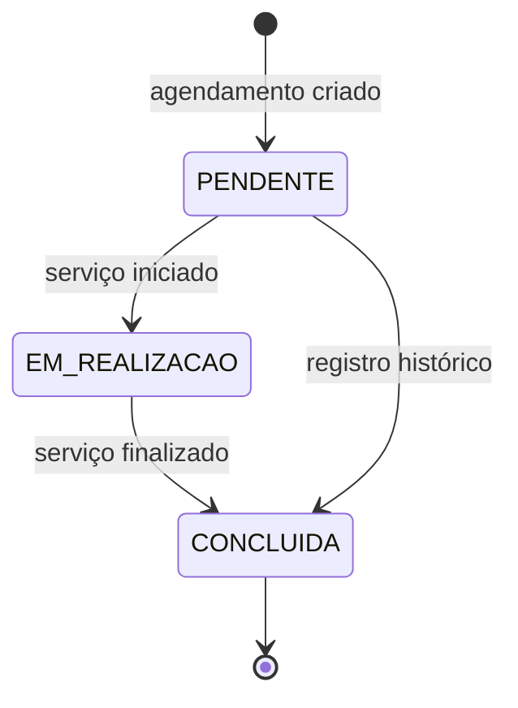
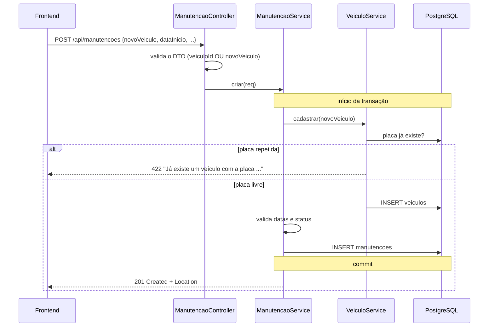
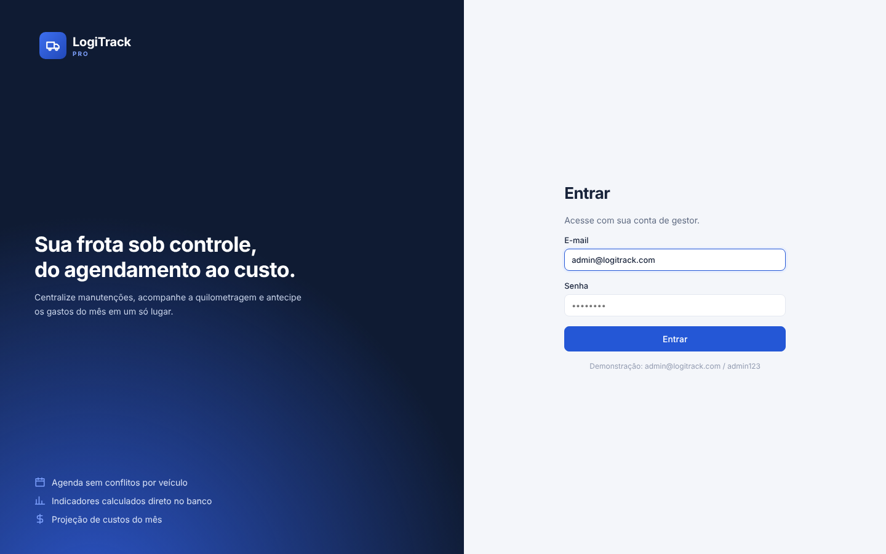
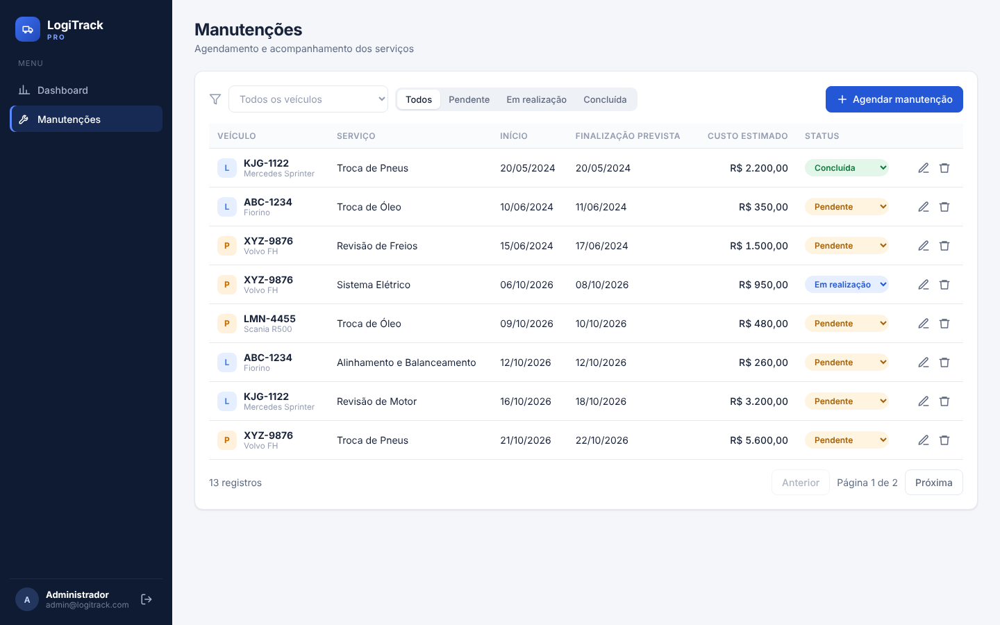
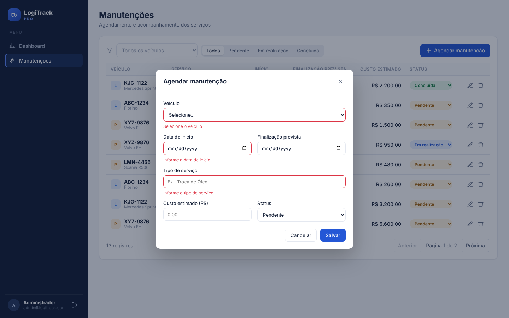
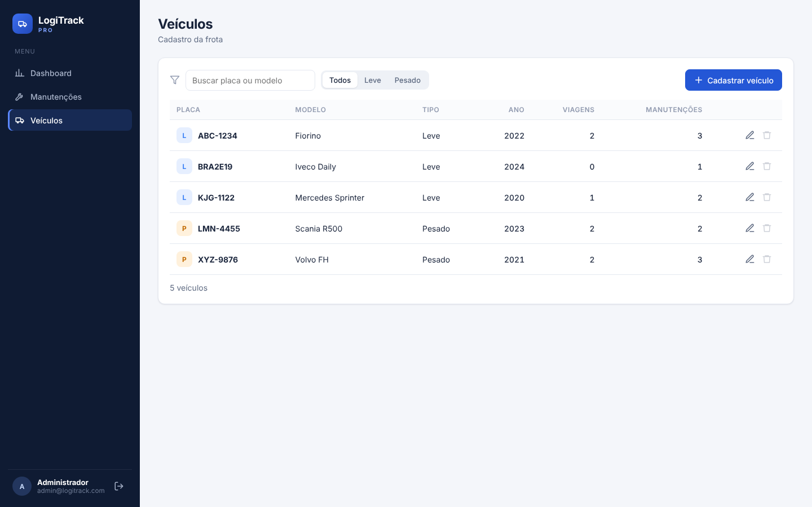
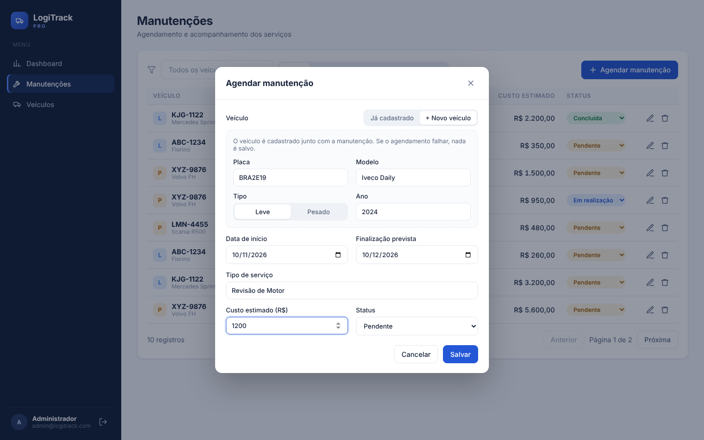

# LogiTrack Pro — Módulo de Agendamento de Manutenção

MVP de gestão de frota desenvolvido para o Desafio Técnico LogAp: **CRUD de agendamento de manutenção** (Opção 2), **CRUD de veículos** e **dashboard** com as 5 métricas extraídas via SQL.

Um veículo novo pode ser cadastrado na tela de Veículos ou direto no agendamento de manutenção (opção "+ Novo veículo"), sem sair do formulário.

## Demonstração online

| | Link |
|---|---|
| Sistema | https://logitrack-web-ayde.onrender.com |
| Documentação da API (Swagger) | https://logitrack-api-b54s.onrender.com/swagger-ui.html |

Login: `admin@logitrack.com` / `admin123`

> Hospedado no plano gratuito da Render: a API hiberna após 15 minutos sem uso, e **o primeiro acesso pode levar cerca de 1 minuto**. Se o login falhar de primeira, aguarde e tente de novo.



## Stack

| Camada | Tecnologia |
|---|---|
| Backend | Java 17+ (testado com 21), Spring Boot 3.3, Spring Data JPA, Spring Security (JWT HS256), Bean Validation |
| Banco | PostgreSQL 16 + Flyway (migrações versionadas) |
| Frontend | React 19 + Vite (SPA), CSS próprio, gráficos em SVG puro |
| DevOps | Docker / Docker Compose |

## Como rodar

### Opção A — Docker (mais simples)

```bash
docker compose up --build
```

- Frontend: http://localhost:3000
- API: http://localhost:8080
- Documentação da API (Swagger): http://localhost:8080/swagger-ui.html
- Login: `admin@logitrack.com` / `admin123`

### Opção B — Local

Pré-requisitos: JDK 17+, Maven 3.9+, Node 20+, PostgreSQL 16.
No Windows, `scripts/instalar-ambiente.bat` instala tudo via winget e cria o banco.

```bash
# 1. Banco
psql -U postgres -c "CREATE DATABASE logitrack;"

# 2. API  (o Flyway cria as tabelas e carrega os dados na primeira execução)
cd backend
mvn spring-boot:run

# 3. Frontend (outro terminal)
cd frontend
npm install
npm run dev        # http://localhost:5173
```

Documentação da API: http://localhost:8080/swagger-ui.html

Variáveis de ambiente opcionais da API: `DB_URL`, `DB_USER`, `DB_PASSWORD`, `JWT_SECRET` (≥ 32 caracteres), `CORS_ORIGENS`, `ADMIN_EMAIL`, `ADMIN_SENHA`.

Testes: `cd backend && mvn test`.


### Opção C — Deploy gratuito (Render + Neon)

A API e o site rodam na [Render](https://render.com) e o banco no [Neon](https://neon.tech), ambos no plano gratuito. O `render.yaml` na raiz descreve os dois serviços.

1. **Neon:** crie um projeto na região **AWS US East 2 (Ohio)**, perto da Render. Em *Connect*, desative *Connection pooling* e copie host, banco, usuário e senha. A conexão direta é a recomendada para as migrações do Flyway.
2. **Render:** *New → Blueprint*, selecione este repositório e preencha:

   | Variável | Valor |
   |---|---|
   | `DB_URL` | `jdbc:postgresql://<host-do-neon>/<banco>?sslmode=require` |
   | `DB_USER` / `DB_PASSWORD` | usuário e senha do Neon |
   | `CORS_ORIGENS` | endereço do site, ex.: `https://logitrack-web-ayde.onrender.com` (sem `/` no final) |
   | `VITE_API_URL` | endereço da API, ex.: `https://logitrack-api-b54s.onrender.com` (só o domínio, sem `/` no final) |

   `JWT_SECRET` é gerado pela própria Render.

   Se o nome do serviço já existir na Render, ela acrescenta um sufixo ao endereço (ex.: `-ayde`). Use sempre o endereço que aparece no topo de cada serviço. Depois de mudar `VITE_API_URL`, faça um novo deploy do site, porque o valor é gravado no build.
3. Na primeira subida, o Flyway cria as tabelas e carrega os dados no Neon.

No plano gratuito, a API hiberna após 15 minutos sem acesso, e **o primeiro acesso depois disso leva cerca de 1 minuto**. Localmente nada muda: sem essas variáveis, a aplicação usa os valores padrão (porta 8080, banco em `localhost`).

## Arquitetura



```
backend/src/main/java/br/com/logitrack
├── config/        Segurança (JWT), OpenAPI/Swagger, Clock, seed do usuário admin
├── controller/    Endpoints REST (manutenções, veículos, dashboard, login) — só traduzem HTTP <-> serviço
├── service/       Regras de negócio e transações
├── domain/        Entidades JPA e enums (modelo rico: a entidade valida a si mesma)
├── repository/    Spring Data (CRUD) + JdbcTemplate (SQL nativo do dashboard)
├── dto/           Records de entrada/saída — a entidade nunca é exposta na API
└── exception/     Exceções de negócio + handler global (RFC 7807 / ProblemDetail)
```

**Decisões principais**

- **Camadas bem separadas.** Controller não conhece JPA; service não conhece HTTP; DTOs (`record`) isolam o contrato da API das entidades.
- **Modelo rico.** Regras que só dependem da própria manutenção (finalização ≥ início, concluída exige data de finalização) ficam na entidade `Manutencao`. Regras que dependem de outros registros (conflito de agenda) ficam no `ManutencaoService`.
- **Veículo novo no agendamento.** `ManutencaoRequest` aceita `veiculoId` (existente) **ou** `novoVeiculo` (dados para cadastro) — exatamente um dos dois, validado com `@AssertTrue`. O cadastro do veículo e o da manutenção rodam na mesma transação: se a manutenção for recusada, o veículo também não é salvo.
- **Placa única e normalizada.** `Veiculo.normalizarPlaca` grava sempre no mesmo formato (`ABC-1234` ou Mercosul `ABC1D23`), então "abc1234" e "ABC-1234" são detectadas como a mesma placa.
- **Exclusão protegida.** Um veículo com viagens ou manutenções não pode ser excluído: isso apagaria a quilometragem e os custos usados no dashboard.
- **Conflito de agenda.** O mesmo veículo não pode ter duas manutenções não concluídas com períodos sobrepostos — é exatamente o "erro de agendamento" citado no contexto do desafio.
- **Dashboard em SQL nativo.** As 5 métricas são agregadas no banco (`DashboardRepository`, `NamedParameterJdbcTemplate`), a aplicação só recebe o resultado. Existe um endpoint agregado (`GET /api/dashboard`) para a tela abrir com uma requisição só, e endpoints individuais por métrica.
- **Flyway** versiona o schema: `V1` é o script original sem alterações, `V2` traz os ajustes, `V3` os dados de demonstração. `ddl-auto=validate` garante que entidade e banco não divergem.
- **Segurança stateless.** Login devolve um JWT assinado (HS256) usando o resource server do próprio Spring Security — sem bibliotecas de terceiros. Senhas com BCrypt.
- **`Clock` injetável** com fuso `America/Sao_Paulo`: "hoje" e "mês atual" são determinísticos e testáveis.
- **Erros padronizados** em `application/problem+json`, com mapa `campos` nos erros de validação — o front mostra a mensagem embaixo de cada campo.
- **Frontend sem dependências além do React.** Gráficos (barras e rosca) em SVG, navegação por hash e um cliente HTTP único (`api.js`) que injeta o token e trata 401.

## Alterações no banco (`V2__ajustes_modelagem.sql`)

| Alteração | Justificativa |
|---|---|
| `status NOT NULL` + `CHECK` com os 3 valores | O script original aceitava qualquer texto; agora o banco garante o domínio. |
| `veiculo_id` e `tipo_servico` `NOT NULL` | Manutenção sem veículo ou sem serviço não faz sentido. |
| `CHECK data_finalizacao >= data_inicio`, `custo >= 0`, `km >= 0` | Última linha de defesa, mesmo que a API seja contornada. |
| Índices em `viagens(veiculo_id)`, `manutencoes(veiculo_id)`, `manutencoes(data_inicio)`, `manutencoes(status, data_inicio)` | O PostgreSQL não indexa FKs automaticamente; os índices atendem os JOINs/GROUP BY do dashboard, o cronograma e a projeção mensal. |
| Tabela `usuarios` | Autenticação (diferencial). O admin é criado pela aplicação na primeira execução, com hash BCrypt gerado pelo próprio `PasswordEncoder`. |

### `V4__protecao_veiculos.sql`

| Alteração | Justificativa |
|---|---|
| FKs de `viagens` e `manutencoes` trocadas de `ON DELETE CASCADE` para `ON DELETE RESTRICT` | Com o CRUD de veículos, excluir um veículo apagaria em silêncio todo o histórico dele. O banco agora recusa, e a API devolve uma mensagem clara antes disso. |
| `CHECK ano BETWEEN 1950 AND 2100` | Mesmo intervalo validado na API. |
| `veiculos.tipo NOT NULL` | Todo veículo precisa de categoria para a métrica "Volume por categoria". |

`V3__dados_demonstracao.sql` adiciona viagens e manutenções com **datas relativas a `CURRENT_DATE`** — as manutenções da carga original são de 2024, então sem isso o cronograma e a projeção do mês ficariam sempre vazios.

## Métricas do dashboard (SQL)

| # | Métrica | Consulta |
|---|---|---|
| 1 | Total de KM (veículo ou frota) | `SUM(km_percorrida)` com filtro opcional por `veiculo_id` |
| 2 | Volume por categoria | `COUNT(viagens)` agrupado por `veiculos.tipo` (LEFT JOIN — categoria sem viagem aparece com 0) |
| 3 | Cronograma | Manutenções não concluídas com `data_inicio >= hoje`, `ORDER BY data_inicio LIMIT 5` |
| 4 | Ranking de utilização | `SUM(km)` por veículo, `ORDER BY total DESC` — o primeiro é o de maior utilização |
| 5 | Projeção financeira | `SUM(custo_estimado)` com `data_inicio` no intervalo `[1º dia do mês, 1º dia do mês seguinte)` — comparação por intervalo usa o índice, ao contrário de `EXTRACT(MONTH ...)` |

## Modelo de dados



## Documentação da API (Swagger / OpenAPI)

Com o backend rodando, acesse **http://localhost:8080/swagger-ui.html**.

- A especificação OpenAPI 3 é gerada pelo [springdoc-openapi](https://springdoc.org) a partir dos controllers e fica em `/v3/api-docs`.
- Cada rota tem resumo, parâmetros, exemplos e as respostas de erro possíveis. O `POST /api/manutencoes` traz dois exemplos prontos: com veículo já cadastrado e com veículo novo.
- Para testar: faça o login em `POST /api/auth/login`, copie o `token`, clique em **Authorize** e cole. O token continua salvo se você recarregar a página.
- As descrições de cada seção têm **diagramas Mermaid** (arquitetura, modelo de dados, login, ciclo de status, agendamento com veículo novo, exclusão de veículo e métricas). O Swagger UI padrão mostra esses blocos como texto, por isso a página `static/swagger-ui.html` carrega o Mermaid e desenha os diagramas. Ela usa o Swagger UI e o Mermaid via CDN, então precisa de internet.
- Os textos ficam em `backend/src/main/resources/openapi/*.md`, separados do código Java (`OpenApiConfig` os carrega).

### Ciclo de vida da manutenção



### Agendamento com veículo novo



## API

Todas as rotas (exceto login) exigem `Authorization: Bearer <token>`.

| Método | Rota | Descrição |
|---|---|---|
| POST | `/api/auth/login` | Autentica e devolve o JWT |
| GET | `/api/veiculos` | Lista simples de veículos (campos de seleção) |
| GET | `/api/veiculos/resumo?tipo=&busca=` | Lista da tela de veículos com nº de viagens e manutenções |
| GET | `/api/veiculos/{id}` | Detalhe |
| POST | `/api/veiculos` | Cadastra (201 + `Location`); placa repetida → 422 |
| PUT | `/api/veiculos/{id}` | Atualiza |
| DELETE | `/api/veiculos/{id}` | Exclui (204); com histórico → 422 |
| GET | `/api/manutencoes?status=&veiculoId=&page=&size=&sort=` | Listagem paginada e filtrável |
| GET | `/api/manutencoes/{id}` | Detalhe |
| POST | `/api/manutencoes` | Agenda (201 + `Location`). Corpo com `veiculoId` **ou** `novoVeiculo: {placa, modelo, tipo, ano}` |
| PUT | `/api/manutencoes/{id}` | Atualiza |
| PATCH | `/api/manutencoes/{id}/status` | Troca só o status |
| DELETE | `/api/manutencoes/{id}` | Exclui (204) |
| GET | `/api/dashboard` | As 5 métricas em uma chamada |
| GET | `/api/dashboard/km-total?veiculoId=` · `/volume-categoria?tipo=` · `/cronograma` · `/ranking` · `/projecao-financeira` | Métricas individuais |

## Telas

| Login | Manutenções | Formulário com validação |
|---|---|---|
|  |  |  |

| Veículos | Agendamento com veículo novo |
|---|---|
|  |  |
