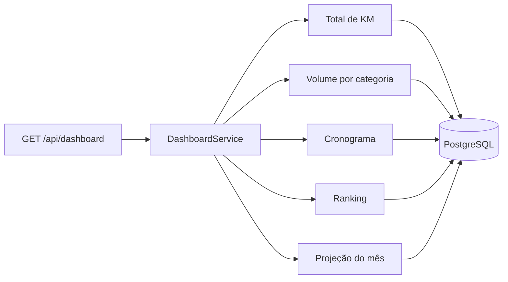

As 5 métricas do desafio, calculadas por SQL nativo no `DashboardRepository`. A aplicação recebe o resultado já agregado pelo banco.

| Métrica | Rota | Consulta |
|---|---|---|
| Total de KM | `/km-total?veiculoId=` | `SUM(km_percorrida)`, de um veículo ou da frota |
| Volume por categoria | `/volume-categoria?tipo=` | `COUNT` de viagens agrupado por tipo de veículo |
| Cronograma | `/cronograma` | 5 próximas manutenções não concluídas, por data |
| Ranking de utilização | `/ranking` | `SUM(km)` por veículo, do maior para o menor |
| Projeção financeira | `/projecao-financeira` | `SUM(custo_estimado)` das manutenções do mês atual |

`GET /api/dashboard` devolve as 5 de uma vez, para a tela abrir com uma única requisição.

