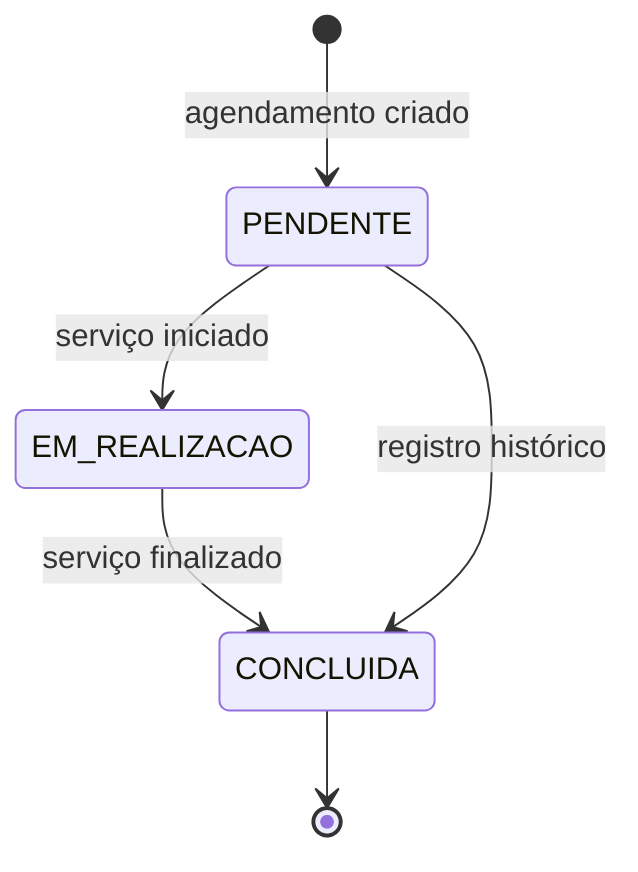
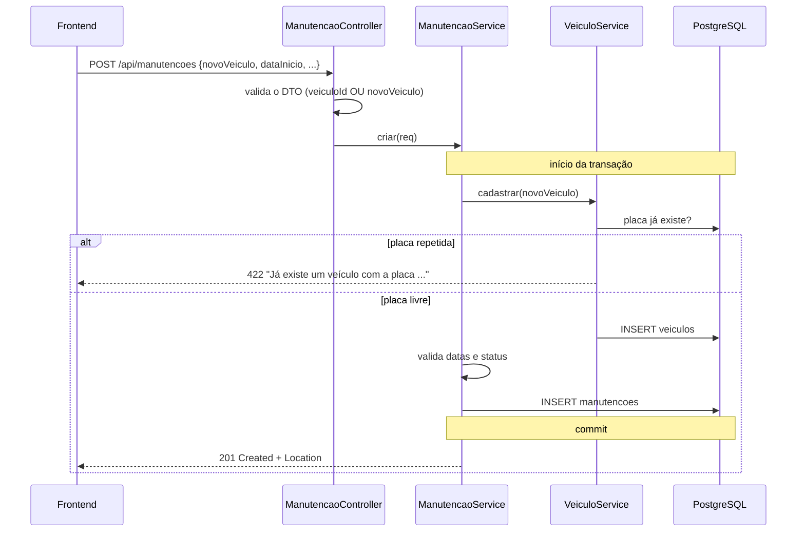

CRUD do agendamento de manutenção. O veículo pode ser um **já cadastrado** (`veiculoId`) ou um **novo** (`novoVeiculo`), nunca os dois.

**Regras de negócio**
- A data de finalização não pode ser anterior à de início.
- Para concluir, a data de finalização é obrigatória (`PATCH /status` preenche com hoje se faltar).
- O mesmo veículo não pode ter duas manutenções não concluídas com períodos sobrepostos.

### Ciclo de vida do status

### Agendar com um veículo novo

O veículo e a manutenção são gravados na mesma transação: se a manutenção for recusada, o veículo também não é salvo.

