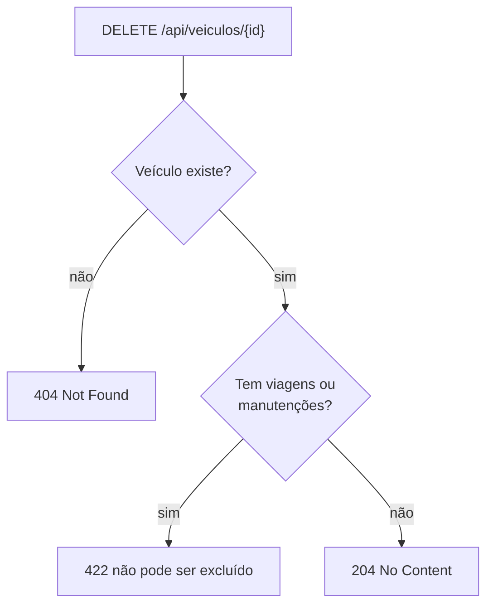

CRUD de veículos.

- A placa aceita o padrão antigo (`ABC-1234`) e o Mercosul (`ABC1D23`), com ou sem hífen, e é gravada sempre no mesmo formato. Por isso `abc1234` e `ABC-1234` contam como a mesma placa.
- A placa é única: repetir uma placa devolve `422`.
- Um veículo com viagens ou manutenções não pode ser excluído (`422`), para não apagar o histórico usado no dashboard.

