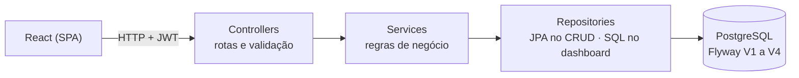
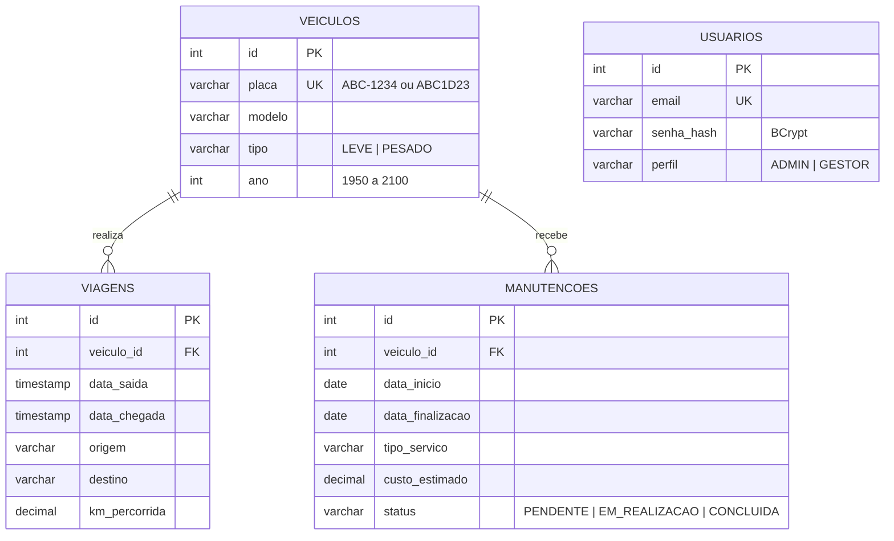

API do **LogiTrack Pro**: agendamento de manutenção, cadastro de veículos e dashboard da frota.

**Como testar aqui:** chame `POST /api/auth/login` com `admin@logitrack.com` / `admin123`, copie o `token` da resposta, clique em **Authorize** e cole o token. As demais rotas passam a responder.

Erros seguem o padrão RFC 7807 (`application/problem+json`): `detail` traz a mensagem e, em erros de validação, `campos` traz a mensagem de cada campo.

### Arquitetura

### Modelo de dados

As chaves estrangeiras usam `ON DELETE RESTRICT` (migração V4): um veículo com viagens ou manutenções não pode ser excluído.
